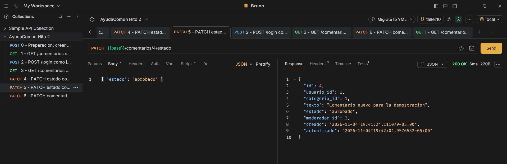
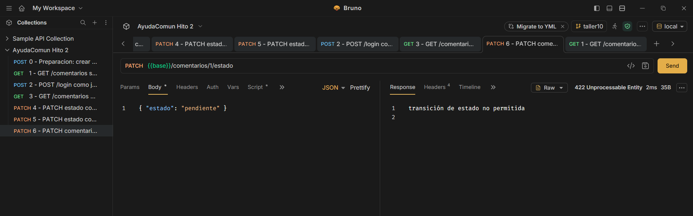

# Peticiones del taller 10

| Petición | Antes | Después |
| --- | --- | --- |
| 1 sin token | 401 | 401 |
| 2 login | 200 | 200 |
| 3 con token | 200 | 200 |
| 4 rol sin permiso | 403 | 403 |
| 5 cambio permitido | 200 | 200 |
| 6 transición prohibida | 422 | 422 |

La petición 0 (crear un registro nuevo, 201) se corre antes de la 4 y la 5.
«Antes» son los códigos del hito 2, antes de tocar el código. «Después» son los de este taller, con los DTO y el repositorio de sqlc ya conectado. No cambió ningún código.

## Paso 2.1 · Cuerpo con id y estado inventados
(Se completa con el resultado de la prueba.)

Se envió con el token de Jose: {"id":77,"estado":"destacado","usuario_id":2,"texto":"prueba paso 2.1"}

Resultado: se creó con id 7 (no 77), estado pendiente y usuario_id 1 (el del token). El DTO ignora id, estado y usuario_id; los fija el servidor.

